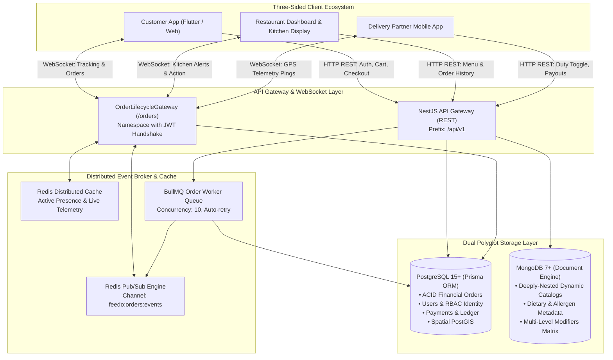

# Feedo Enterprise Event-Driven Microservices Architecture

> High-throughput, distributed event-driven backend architecture for a three-sided food delivery platform (**Customer**, **Restaurant Partner**, and **Delivery Partner**). Built with **NestJS**, **TypeScript**, **PostgreSQL (Prisma ORM)**, **MongoDB**, **Redis Session Caching & Pub/Sub**, and **Socket.IO WebSockets**.

---

## 🏗️ Polyglot Persistence & Event-Driven Topology



---

## 📡 Three-Sided WebSocket Event Lifecycle

All WebSocket payloads follow strict TypeScript interfaces in [`order-events.schema.ts`](file:///c:/Users/Deepika%20v/foodapp/apps/api/src/modules/websockets/events/order-events.schema.ts):

| Step | Event Name | Direction | Source Role | Target Room | Purpose |
|---|---|---|---|---|---|
| 1 | `order:placed` | Outbound | System / API | `restaurant:<id>` | Alert restaurant kitchen of incoming order & SLA deadline |
| 2 | `restaurant:order_action` | Inbound | `RESTAURANT_STAFF` | Gateway | Kitchen accepts or rejects the incoming order |
| 3 | `restaurant:accepted` | Outbound | Gateway / Redis | `order:<orderId>` | Broadcasts confirmation & triggers courier dispatch matching |
| 4 | `kitchen:status_update` | Inbound | `RESTAURANT_STAFF` | Gateway | Kitchen triggers food preparation stage (`PREPARING` ➔ `READY_FOR_PICKUP`) |
| 5 | `kitchen:ready_for_pickup`| Outbound | Gateway / Redis | `order:<orderId>`, `courier:<id>` | Signals courier order is bagged and ready for handoff |
| 6 | `courier:location_ping` | Inbound | `DELIVERY_PARTNER` | Gateway | Real-time GPS coordinates stream (`lat`, `lng`, `bearing`, `speed`) |
| 7 | `courier:location_update` | Outbound | Gateway / Redis | `order:<orderId>` | Streams smooth live marker movement to Customer tracking UI |
| 8 | `order:delivered` | Outbound | Gateway | `order:<orderId>` | Final delivery confirmation via customer drop OTP |
| 9 | `server:maintenance_notice`| Outbound | Gateway | Global Broadcast | Pre-shutdown zero-downtime notice before client auto-reconnect |

---

## 🗄️ Dual-Database Persistence Strategy

### 1. PostgreSQL (Relational Core via Prisma)
- **Role:** Handles core ACID financial ledgers, transactional consistency, user authentication, order states, payments, and PostGIS spatial queries.
- **Connection Pooling:** Configured with `connection_limit=25` and `pool_timeout=20s`.
- **Query Telemetry:** Logs execution times; emits warnings on slow queries exceeding `200ms`.

### 2. MongoDB (Dynamic Document Catalog)
- **Role:** Houses highly dynamic, deeply nested restaurant menus with variable schema definitions.
- **Document Structure:** Supports dietary flags (`VEGAN`, `JAIN`, `GLUTEN_FREE`), allergen checklists, caloric breakdowns, and multi-select modifier trees.
- **Connection Pooling:** Initialized via `MongoClient` with `minPoolSize=10` and `maxPoolSize=50`.
- **Caching:** Frequently queried catalogs are cached in Redis (`catalog:restaurant:<id>`) with automated cache invalidation upon updates.

---

## 🚀 Running & Verification

```powershell
# Typecheck entire TypeScript backend
npx tsc --project apps/api/tsconfig.json --noEmit

# Compile to production distribution
npm run build:api

# Start production API server
npm run start:api
```

- **HTTP API Gateway:** `http://localhost:3000/api/v1`
- **WebSocket Gateway:** `ws://localhost:3000/orders` (or `http://localhost:3000/orders`)
- **Swagger Documentation:** `http://localhost:3000/api/docs`
- **Readiness Health Probe:** `http://localhost:3000/api/v1/health/readiness`
