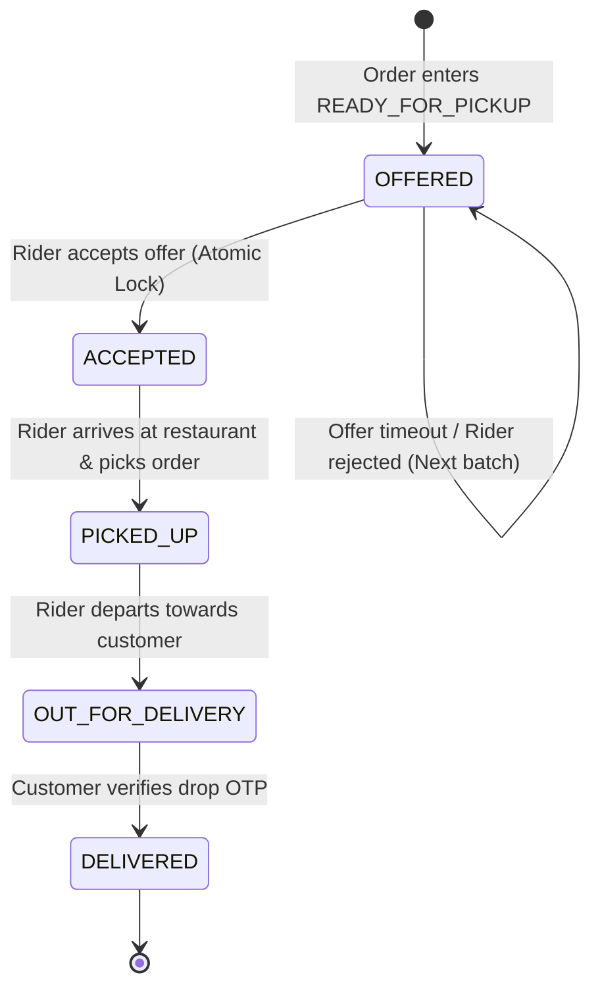

# CraveCart Delivery Partner & Dispatch Workflow

This document details the complete dispatch engine, atomic offer claiming, GPS telemetry, OTP-verified dropoff, and rider earnings computation for delivery operations.

---

## 1. Delivery State Machine & Lifecycle



---

## 2. Dispatch Engine & Atomic Offer Claiming

### Step 1: Offer Generation
When a restaurant kitchen marks an order `READY_FOR_PICKUP` (or when prep time reaches 5 minutes remaining):
1. Dispatch Engine identifies eligible delivery partners:
   - Must have `accountStatus: ACTIVE`
   - Must be `isOnline: true`
   - Must be within a 5 km geofence radius of the restaurant
   - Must have no more than 1 active stacked order
2. Creates a `DeliveryAssignment` record with `status: OFFERED` and a 45-second acceptance window countdown.
3. Emits a WebSocket notification `delivery:offer_received` to nearby delivery partner devices.

### Step 2: Atomic Claiming (Race Condition Prevention)
Multiple riders within the area may see the notification. To ensure only one rider receives the delivery assignment without race conditions, the backend uses atomic database locking:

```ts
// Atomic assignment claim in Prisma transaction
export async function claimDeliveryOffer(orderId: string, driverId: string) {
  return await prisma.$transaction(async (tx) => {
    // 1. Select for update with condition
    const assignment = await tx.deliveryAssignment.findUnique({
      where: { orderId },
    });

    if (!assignment || assignment.status !== 'OFFERED') {
      throw new ConflictException('This delivery has already been accepted by another partner.');
    }

    // 2. Atomic update
    const updated = await tx.deliveryAssignment.update({
      where: { orderId },
      data: {
        driverId,
        status: 'ACCEPTED',
        acceptedAt: new Date(),
      },
    });

    // 3. Mark driver active assignment
    await tx.user.update({
      where: { id: driverId },
      data: { isOnline: false }, // busy with active task
    });

    return updated;
  });
}
```

---

## 3. Order Pickup & Delivery Drop Verification

### Pickup at Restaurant
1. Rider arrives at restaurant.
2. Compares Order Number (`#CC-8821-492`) with the merchant.
3. Merchant confirms packaging.
4. Rider taps **"Confirm Pickup"** in Feedo Delivery Partner App (`POST /api/v1/delivery/pickup`).
5. Order status transitions to `PICKED_UP`. Customer receives instant tracking notification.

### Out for Delivery & GPS Telemetry
1. Rider taps **"Start Delivery"** (`POST /api/v1/delivery/out-for-delivery`).
2. Mobile background geolocation service streams GPS coordinates every 5 seconds:
   ```http
   POST /api/v1/delivery/location
   Authorization: Bearer <driver_token>
   Content-Type: application/json

   {
     "lat": 12.9785,
     "lng": 77.6408,
     "heading": 142.5,
     "speed": 24.0,
     "orderId": "order-uuid-v4"
   }
   ```
3. Backend Socket.IO Gateway broadcasts coordinates to room `order:order-uuid-v4`.  
   Customer mobile app smoothly animates the rider marker across Google Maps / Mapbox.

### Dropoff Verification with Customer OTP
To prevent fraudulent deliveries and misplaced orders:
1. Customer is provided a unique 4-digit or 6-digit Delivery PIN (`dropOtp: "204815"`) displayed in their active tracking screen.
2. Upon arrival at the customer doorstep, the rider requests the PIN.
3. Rider enters the OTP in the delivery app:
   ```http
   POST /api/v1/delivery/complete
   Authorization: Bearer <driver_token>
   Content-Type: application/json

   {
     "orderId": "order-uuid-v4",
     "otp": "204815"
   }
   ```
4. Backend verifies OTP against the hashed order snapshot.  
   If matched:
   - Order transitions to `DELIVERED`.
   - Rider earning is credited to their wallet ledger.
   - Customer app prompts for a 5-star rating & review.

---

## 4. Delivery Partner Earnings & Wallet Ledger

Driver earnings are computed with transparency and deposited into their wallet immediately upon delivery:

```
Total Earning = Base Fee + (Distance KM * Distance Rate) + Peak Surge + 100% Customer Tip
```

### Example Calculation:
- **Base Pickup & Drop Fee:** ₹30.00 (3,000 paise)
- **Distance Pay:** 3.5 km × ₹8.00/km = ₹28.00 (2,800 paise)
- **Peak Hour Surge:** ₹15.00 (1,500 paise)
- **Customer Tip:** ₹20.00 (2,000 paise) — *100% passed to driver*
- **Total Driver Payout:** **₹93.00** (9,300 paise)

The amount is recorded in `DriverEarning` with an immutable double-entry ledger record.  
Drivers can initiate instant UPI payouts to their bank accounts on a daily or weekly schedule.

