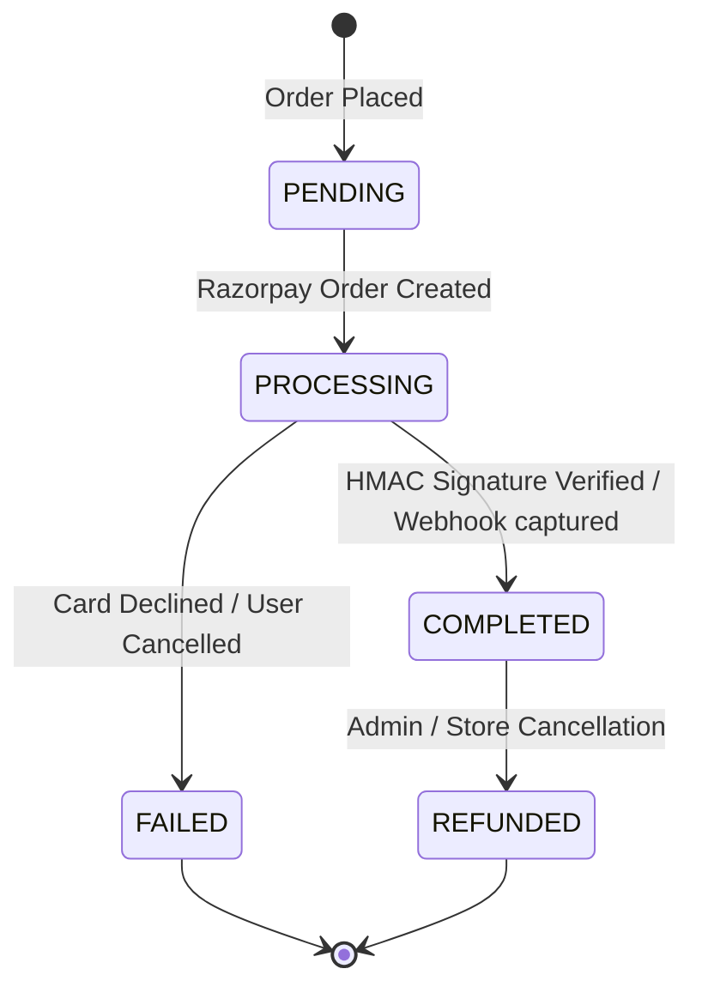

# CraveCart Payments & Financial Engine Documentation

This document specifies the payment architecture, Razorpay test mode integration, integer-paise financial modeling, signature verification, and webhook idempotency for the CraveCart ecosystem.

---

## 1. Golden Financial Rule: Integer Paise Only

> [!IMPORTANT]
> **Floating-point numbers are strictly forbidden for currency operations.**  
> Floating-point arithmetic introduces IEEE-754 binary floating-point errors (e.g. `0.1 + 0.2 === 0.30000000000000004`).  
> All monetary amounts in the database, REST APIs, WebSocket events, and internal ledgers are modeled and stored as **signed 32/64-bit integers in Indian Paise** (`1 INR = 100 Paise`).

| Display Amount | Internal Unit | DB / API Representation |
| :--- | :--- | :--- |
| ₹1.00 | 100 paise | `100` |
| ₹225.50 | 22550 paise | `22550` |
| ₹500.00 | 50000 paise | `50000` |
| ₹1,299.00 | 129900 paise | `129900` |

Formatting for UI representation uses integer division and modulo:
```ts
export function formatCurrencyPaise(paise: number): string {
  const rupees = (paise / 100).toFixed(2);
  return `₹${rupees}`;
}
```

---

## 2. Payment Lifecycle & State Machine



---

## 3. Razorpay Integration Architecture

### Step 1: Backend Order Creation (`POST /api/v1/payments/create-razorpay-order`)
When a customer confirms checkout, the backend creates an order with Razorpay:
```http
POST /api/v1/payments/create-razorpay-order
Authorization: Bearer <customer_token>
Content-Type: application/json

{
  "orderId": "order-uuid-v4",
  "amountPaise": 43250
}
```
**Backend Action:**
1. Validates that the order exists, belongs to the authenticated customer, and has status `PENDING`.
2. Computes the authoritative server-side price in integer paise.
3. Invokes Razorpay Orders API:
   ```ts
   const rzpOrder = await razorpay.orders.create({
     amount: order.finalTotalPaise, // in paise
     currency: 'INR',
     receipt: order.id,
     notes: { orderNumber: order.orderNumber }
   });
   ```
4. Stores `providerOrderId` (`order_Rzp...`) in the DB `Payment` record with status `PROCESSING`.

### Step 2: Client Checkout Execution
The mobile or web client initializes the Razorpay Standard Checkout modal using the returned `razorpayOrderId`.

### Step 3: Server-Side Signature Verification (`POST /api/v1/payments/verify`)
When the payment completes on the client, Razorpay returns:
- `razorpay_order_id`
- `razorpay_payment_id`
- `razorpay_signature`

The client submits these to `/api/v1/payments/verify`.  
The backend verifies the cryptographic authenticity using HMAC SHA-256:

```ts
import * as crypto from 'crypto';

export function verifyRazorpaySignature(
  orderId: string,
  paymentId: string,
  signature: string,
  secret: string
): boolean {
  const payload = `${orderId}|${paymentId}`;
  const expectedSignature = crypto
    .createHmac('sha256', secret)
    .update(payload)
    .digest('hex');

  return crypto.timingSafeEqual(
    Buffer.from(signature, 'utf-8'),
    Buffer.from(expectedSignature, 'utf-8')
  );
}
```

> [!CAUTION]
> Never verify payment signatures on the client side. The backend is the sole authority for marking orders as `PAID`.

---

## 4. Webhook Ingestion & Idempotency Protection

Network interruptions or app crashes can prevent client callbacks. Webhooks act as the reliable fallback.

### Webhook Signature Verification
Razorpay sends an `x-razorpay-signature` header computed from the raw HTTP body and your webhook secret:
```ts
const isValid = crypto
  .createHmac('sha256', process.env.RAZORPAY_WEBHOOK_SECRET)
  .update(req.rawBody)
  .digest('hex') === req.headers['x-razorpay-signature'];
```

### Idempotency & Replay Protection
Webhooks may be retried multiple times by Razorpay.  
Every incoming event is recorded in the `WebhookEvent` table with a unique constraint on `eventId`.
```sql
CREATE UNIQUE INDEX "WebhookEvent_eventId_key" ON "WebhookEvent"("eventId");
```
If a duplicate `eventId` is received, the backend returns `200 OK` immediately without re-processing state changes or financial ledger entries.

---

## 5. Refunds & Reversals

When an order is rejected by a restaurant or cancelled by customer service before prep starts:
1. Backend issues a refund via Razorpay Refund API:
   ```ts
   await razorpay.payments.refund(payment.providerPaymentId, {
     amount: payment.amountPaise,
     notes: { reason: cancellationReason }
   });
   ```
2. Payment record transitions to `REFUNDED`.
3. Order record transitions to `CANCELLED`.
4. Restaurant ledger entry is adjusted to zero out receivables.
5. Customer is notified via real-time WebSocket and push notification.

---

## 6. Development & Test Mode Credentials

For local development and testing, use Razorpay Test credentials:
```ini
RAZORPAY_KEY_ID=rzp_test_51NgQ7Cravecart
RAZORPAY_KEY_SECRET=cravetestsecret99201481
RAZORPAY_WEBHOOK_SECRET=cravecart_webhook_secret_key
```
In test mode, Razorpay provides mock card numbers and mock UPI handles (e.g., `success@razorpay`) to simulate payments, 3D Secure failures, and refunds without real money transactions.

