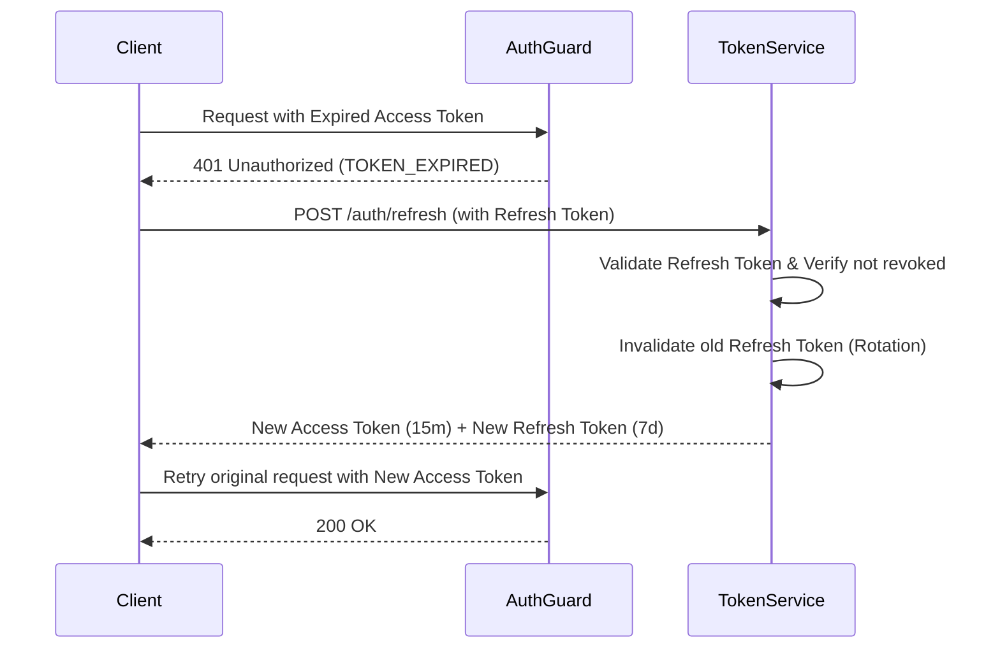

# CraveCart Security Architecture & Defense In Depth

This document outlines the security controls, authentication safeguards, cryptographic standards, and tenant isolation policies enforced across CraveCart.

---

## 1. Password Security & Storage

All user passwords must satisfy the enterprise complexity policy:
- Minimum 8 characters, maximum 72 characters (bcrypt truncates after 72 bytes).
- At least 1 uppercase letter, 1 lowercase letter, 1 numeric digit, and 1 special symbol.
- Hashed using **bcrypt** with a minimum cost factor of `10` or **Argon2id**:
  ```ts
  const salt = await bcrypt.genSalt(10);
  const passwordHash = await bcrypt.hash(rawPassword, salt);
  ```
- Password hashes are marked as private and strictly excluded from API responses and serialization decorators.

---

## 2. Dual-Token JWT & Refresh Token Rotation

CraveCart implements dual-token authentication to minimize exposure of credentials:



### Access Token Characteristics:
- **Lifespan:** Short-lived (`15 minutes`).
- **Signature:** Signed using HMAC SHA-256 (`JWT_ACCESS_SECRET`, min 256 bits).
- **Payload:** Contains `sub` (userId), `email`, and `role`. Never includes PII or passwords.

### Refresh Token Characteristics:
- **Lifespan:** `7 days`.
- **Storage:** Stored hashed in the database `Session` table.
- **Rotation:** Every time a refresh token is exchanged, the previous token is marked revoked and a brand new refresh token is issued.
- **Revocation / Logout:** When a user logs out or resets their password, all active sessions and refresh tokens for that user ID are invalidated immediately.

---

## 3. Role-Based Access Control (RBAC) & Tenant Isolation

A strict security boundary isolates roles and prevents Insecure Direct Object References (IDOR):

```
+------------------------------------------------------------------+
|                    ROLE PERMISSIONS MATRIX                       |
+-------------------+----------+------------+----------+-----------+
| Endpoint Category | Customer | Restaurant | Delivery | Admin     |
+-------------------+----------+------------+----------+-----------+
| Discovery & Menu  | Read     | Read       | Read     | Read/Write|
| Cart & Checkout   | Own Only | Denied     | Denied   | Denied    |
| Order Creation    | Own Only | Denied     | Denied   | Denied    |
| Order Management  | View Own | Own Store  | Assigned | Full View |
| Kitchen Prep Status| Denied   | Own Store  | Denied   | Override  |
| Dispatch Offers   | Denied   | Denied     | Active   | Full View |
| GPS Telemetry     | Receive  | Denied     | Broadcast| Full View |
| Merchant KYC      | Denied   | Own Store  | Denied   | Approve   |
| Financial Ledger  | Denied   | Own Payout | Own Wallet| Full Audit|
+-------------------+----------+------------+----------+-----------+
```

### Tenant Isolation Rules:
1. **Customer Isolation:** Customers can only read or modify their own carts, saved addresses, and order history (`WHERE userId = req.user.id`).
2. **Restaurant Isolation:** Restaurant staff and owners can only view orders and modify menus for restaurants where they have active membership (`WHERE restaurantId IN (SELECT restaurantId FROM RestaurantMember WHERE userId = req.user.id)`).
3. **Delivery Isolation:** Delivery partners can only access delivery instructions and customer drop locations for orders they have actively accepted (`WHERE driverId = req.user.id`).
4. **Admin Verification:** Platform admin operations require `role === 'ADMIN'` verified cryptographically on every request.

---

## 4. Cryptographic Timing Attack Defense

When verifying Razorpay signatures or webhook HMACs, standard string comparison (`===`) is vulnerable to timing attacks (where attackers deduce correct bytes based on millisecond differences in rejection response times).  
CraveCart enforces constant-time buffer comparison:

```ts
import * as crypto from 'crypto';

export function timingSafeCompare(a: string, b: string): boolean {
  const bufA = Buffer.from(a, 'utf-8');
  const bufB = Buffer.from(b, 'utf-8');

  if (bufA.length !== bufB.length) {
    return false;
  }
  return crypto.timingSafeEqual(bufA, bufB);
}
```

---

## 5. Input Sanitization & Attack Mitigation

1. **SQL Injection:** Mitigated through Prisma ORM parameter binding. No raw string interpolation is permitted in database queries.
2. **Cross-Site Scripting (XSS):** All user-submitted text (delivery notes, reviews, support tickets) is HTML-escaped before presentation.
3. **HTTP Parameter Pollution & Payload Validation:** Strict `class-validator` and `zod` DTO schemas reject unexpected payload properties.
4. **Rate Limiting:** Protects `/auth/login`, `/auth/register`, and `/pricing/calculate` against brute-force attacks using Redis token-bucket rate limiters (max 5 failed login attempts per IP per 15 minutes).
5. **CORS Enforcement:** The API explicitly checks the `Origin` header against `CORS_ORIGINS` and rejects unapproved origins with `403 Forbidden`.

